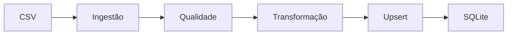

[README_TEXTILE_INTELLIGENCE_PLATFORM.md](https://github.com/user-attachments/files/31288447/README_TEXTILE_INTELLIGENCE_PLATFORM.md)
# Textile Intelligence Platform

> Plataforma de Engenharia de Dados, Machine Learning e IA Generativa aplicada à indústria têxtil.

[](#-status-do-projeto)
[](https://www.python.org/)
[](https://fastapi.tiangolo.com/)
[](https://www.sqlalchemy.org/)
[](https://www.docker.com/)

## 📌 Visão geral

A **Textile Intelligence Platform (TIP)** é um projeto de portfólio que demonstra a construção progressiva de uma plataforma moderna de dados e inteligência artificial aplicada à indústria têxtil.

O projeto simula um ambiente industrial real, começando pela ingestão e qualidade dos dados de máquinas e evoluindo para armazenamento relacional, pipelines de Engenharia de Dados, arquitetura Lakehouse, análises, Machine Learning, MLOps e aplicações de IA Generativa.

A proposta é conectar conhecimento industrial a práticas modernas de tecnologia para apoiar decisões relacionadas a:

- Produção;
- Capacidade das máquinas;
- Planejamento;
- Consumo de matérias-primas;
- Qualidade;
- Manutenção;
- Eficiência operacional.

## 🎯 Problema

Ambientes industriais frequentemente possuem dados distribuídos em planilhas, sistemas isolados e registros com diferentes padrões. Isso dificulta:

- Consolidar informações de produção;
- Garantir a qualidade dos dados;
- Conhecer a capacidade real das máquinas;
- Identificar gargalos e perdas;
- Antecipar falhas;
- Criar indicadores confiáveis;
- Utilizar Machine Learning e IA de forma segura.

## 💡 Proposta da plataforma

```text
Dados industriais
    ↓
Ingestão
    ↓
Qualidade e validação
    ↓
Transformação
    ↓
Persistência
    ↓
Pipelines e Lakehouse
    ↓
Analytics e Machine Learning
    ↓
MLOps e IA Generativa
```

A plataforma está sendo construída de forma incremental. Cada fase produz uma entrega funcional antes da introdução de tecnologias mais avançadas.

## 🧱 Camadas da solução

### 1. Ingestão

- Leitura de arquivos CSV;
- Verificação da existência dos arquivos;
- Carregamento com Pandas;
- Preparação para múltiplas fontes de dados.

### 2. Qualidade de dados

- Validação de colunas obrigatórias;
- Tratamento de valores nulos;
- Identificação de duplicidades;
- Validação de status e capacidade;
- Rejeição de registros inconsistentes.

### 3. Transformação

- Normalização de textos;
- Conversão de datas;
- Conversão de valores numéricos;
- Padronização dos dados antes da persistência.

### 4. Persistência

- Modelagem com SQLAlchemy;
- Sessões e dependências de banco;
- Persistência relacional;
- Estratégia de carga idempotente;
- Upsert para evitar duplicidades.

### 5. Inteligência — evolução planejada

- Indicadores industriais;
- Previsão de demanda;
- Planejamento de produção;
- Manutenção preditiva;
- Otimização de recursos;
- Assistente industrial com IA Generativa e RAG.

## 🔄 Pipeline atual



O pipeline atual valida e transforma dados de máquinas antes de persistir os registros. O SQLite é utilizado nesta fase local; a próxima evolução relevante é a migração para PostgreSQL com Docker.

## 🗂️ Arquitetura do projeto

```text
textile-intelligence-platform/
├── app/
│   ├── api/             # Rotas e endpoints
│   ├── core/            # Configurações do projeto
│   ├── database/        # Conexão, sessão e modelos
│   ├── models/          # Entidades de dados
│   └── services/        # Ingestão, qualidade e transformação
├── data/
│   └── raw/             # Dados brutos de entrada
├── docker/              # Configurações de infraestrutura
├── docs/                # Documentação técnica
├── models/              # Artefatos futuros de Machine Learning
├── notebooks/           # Exploração e experimentos
├── scripts/             # Scripts operacionais
├── tests/               # Testes automatizados
└── .github/              # Workflows e configurações do GitHub
```

> A estrutura pode evoluir conforme novas camadas forem implementadas.

## 🛠️ Tecnologias

### Implementadas ou em uso na fase atual

| Área | Tecnologias |
|---|---|
| Linguagem | Python |
| API | FastAPI e Uvicorn |
| Processamento | Pandas |
| Banco local | SQLite |
| ORM | SQLAlchemy |
| Configuração | Pydantic Settings |
| Testes | Pytest |
| Versionamento | Git e GitHub |

### Planejadas no roadmap

| Área | Tecnologias |
|---|---|
| Banco e infraestrutura | PostgreSQL e Docker |
| Engenharia de Dados | Apache Spark, PySpark e Databricks |
| Armazenamento | Delta Lake e arquitetura Lakehouse |
| Orquestração | Apache Airflow |
| Machine Learning | Scikit-learn e XGBoost |
| MLOps | MLflow |
| Infraestrutura como código | Terraform |
| IA Generativa | OpenAI, LangChain, LangGraph e RAG |
| Busca semântica | Banco de dados vetorial |

As tecnologias planejadas só serão incorporadas quando resolverem uma necessidade concreta da fase correspondente.

## 🚀 Status do projeto

🟡 **Em desenvolvimento**

### ✅ Concluído

- Estrutura inicial do projeto;
- Configuração da API FastAPI;
- Endpoint inicial de status;
- Camada de banco de dados com SQLAlchemy;
- Configuração central com Pydantic Settings;
- Modelo de dados de máquinas;
- Ingestão de CSV com Pandas;
- Validação da qualidade dos dados;
- Transformação dos dados;
- Persistência em SQLite;
- Estratégia de carga idempotente;
- Testes do pipeline de máquinas.

### 🔄 Em andamento

- Consolidação da primeira versão do pipeline;
- Documentação das decisões técnicas;
- Preparação da migração de SQLite para PostgreSQL;
- Preparação do ambiente com Docker.

### ⏭️ Próxima etapa

```text
PostgreSQL + Docker
```

O objetivo é substituir o banco local por uma infraestrutura relacional mais próxima de um ambiente profissional, mantendo o pipeline existente funcional e testável.

## 🧭 Roadmap

```text
CSV / dados brutos
→ Ingestão
→ Data Quality
→ Transformação
→ PostgreSQL
→ Pipeline
→ Databricks / PySpark
→ Delta Lake
→ Lakehouse
→ Analytics / SQL
→ Machine Learning
→ MLOps
→ IA Generativa / RAG
```

### Fase 1 — Fundação

- [x] Organização do projeto;
- [x] API inicial com FastAPI;
- [x] Configuração do banco;
- [x] Modelo inicial de máquinas;
- [x] Testes básicos.

### Fase 2 — Pipeline ETL local

- [x] Ingestão de CSV;
- [x] Qualidade de dados;
- [x] Transformação;
- [x] Persistência;
- [x] Carga idempotente.

### Fase 3 — PostgreSQL e Docker

- [ ] Banco PostgreSQL;
- [ ] Docker Compose;
- [ ] Migração do pipeline;
- [ ] Testes de integração;
- [ ] Persistência de volumes.

### Fase 4 — Engenharia de Dados avançada

- [ ] Pipeline orquestrado;
- [ ] Apache Spark e PySpark;
- [ ] Processamento no Databricks;
- [ ] Monitoramento e tratamento de falhas.

### Fase 5 — Delta Lake e Lakehouse

- [ ] Camada Bronze;
- [ ] Camada Silver;
- [ ] Camada Gold;
- [ ] Versionamento e confiabilidade dos dados;
- [ ] Analytics com SQL.

### Fase 6 — Machine Learning e MLOps

- [ ] Engenharia de atributos;
- [ ] Modelos de previsão;
- [ ] Manutenção preditiva;
- [ ] Rastreamento de experimentos com MLflow;
- [ ] Monitoramento de modelos.

### Fase 7 — IA Generativa e RAG

- [ ] Base de conhecimento industrial;
- [ ] Busca semântica;
- [ ] Assistente para análise operacional;
- [ ] Respostas fundamentadas em dados e documentos;
- [ ] Agentes especializados.

### Fase 8 — Infraestrutura como código

- [ ] Terraform;
- [ ] Ambientes reproduzíveis;
- [ ] Evolução para Cloud;
- [ ] Automação de infraestrutura.

## ⚙️ Configuração local

### Pré-requisitos

- Python 3.11 ou superior;
- Git;
- Ambiente virtual Python;
- Docker, a partir da fase PostgreSQL.

### Instalação

```bash
git clone https://github.com/fernandoPropositoTech/textile-intelligence-platform.git
cd textile-intelligence-platform

python -m venv .venv
```

No Windows PowerShell:

```powershell
.venv\Scripts\Activate.ps1
pip install -r requirements.txt
```

No Linux ou macOS:

```bash
source .venv/bin/activate
pip install -r requirements.txt
```

### Variáveis de ambiente

Crie o arquivo `.env` a partir do `.env.example`, quando disponível. Exemplo para o banco local:

```env
DATABASE_URL=sqlite:///./textile_intelligence.db
```

Nunca envie credenciais ou arquivos `.env` para o GitHub.

### Executar a API

```bash
uvicorn app.main:app --reload
```

Depois, acesse:

- API: `http://127.0.0.1:8000`;
- Documentação Swagger: `http://127.0.0.1:8000/docs`.

### Executar os testes

```bash
pytest
```

## 🧪 Exemplo de fluxo industrial

Um arquivo `machines.csv` pode representar o cadastro e o estado operacional das máquinas:

```text
machine_id,model,status,capacity
M001,SSR14,active,120
M002,SV14,maintenance,95
```

O pipeline:

1. Lê o arquivo;
2. Verifica a estrutura obrigatória;
3. Identifica nulos e duplicidades;
4. Padroniza textos e números;
5. Valida status e capacidade;
6. Persiste os registros de forma idempotente;
7. Disponibiliza os dados para futuras análises.

## 📊 Casos de uso planejados

- Monitoramento de capacidade produtiva;
- Planejamento de máquinas e pedidos;
- Análise de eficiência;
- Previsão de demanda;
- Controle de estoque e consumo de fios;
- Detecção de anomalias;
- Manutenção preditiva;
- Assistente industrial com IA Generativa.

## 📚 Aprendizados demonstrados

Este projeto documenta competências práticas em:

- Organização de projetos Python;
- Desenvolvimento de APIs;
- Engenharia e qualidade de dados;
- Modelagem e persistência relacional;
- Construção de pipelines idempotentes;
- Testes automatizados;
- Containers e infraestrutura;
- Arquitetura Lakehouse;
- Machine Learning, MLOps e IA Generativa.

## ⚠️ Limitações atuais

- Os dados iniciais são simulados para fins de desenvolvimento;
- A persistência atual utiliza SQLite;
- As etapas de Lakehouse, Machine Learning, MLOps e IA Generativa ainda pertencem ao roadmap;
- O projeto ainda não representa um sistema pronto para operação industrial;
- Resultados preditivos futuros precisarão ser validados com dados reais.

## 👨‍💻 Autor

**Fernando Caruzo Bento**

Profissional com mais de 20 anos de experiência na indústria têxtil, especializado em programação industrial, operação de máquinas de alta complexidade e otimização de processos produtivos. Atualmente em transição para Engenharia de Dados, Machine Learning e desenvolvimento de soluções orientadas por IA.

- GitHub: [fernandoPropositoTech](https://github.com/fernandoPropositoTech)
- Repositório: [textile-intelligence-platform](https://github.com/fernandoPropositoTech/textile-intelligence-platform)

## 📄 Licença

Consulte o arquivo [LICENSE](LICENSE) para conhecer os termos de uso do projeto.

---

**Textile Intelligence Platform — conectando experiência industrial, Engenharia de Dados e Inteligência Artificial.**
